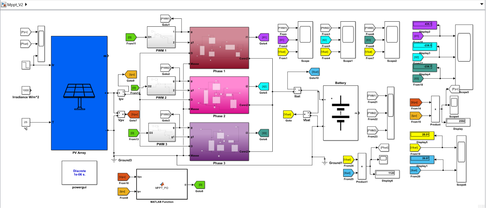

# 4.4 kW 3-Phase Interleaved Solar MPPT & 230 VAC Hybrid Inverter (Fortico R&D)

[](https://scidelo-andriasahy.github.io/?project=2)
[](https://www.kicad.org/)
[](https://www.mathworks.com/products/simulink.html)
[-10b981?style=for-the-badge)](#validated-results)

> **Author:** Tsikomia Scidelo ANDRIASAHY — Power Electronics & Embedded Systems R&D Intern at [Fortico](https://sitewebfortico.vercel.app/fr)  
> **Live Project Showcase:** [https://scidelo-andriasahy.github.io/?project=2](https://scidelo-andriasahy.github.io/?project=2)



## Engineering Architecture
1. **4.4 kW 3-Phase Interleaved Synchronous Buck MPPT (24 VDC / 180 A):**
   - 3 parallel synchronous Buck legs phase-shifted by **120°** (`0°`, `120°`, `240°`) at `40 kHz/phase` (**120 kHz effective output ripple frequency**), reducing phase current to **60 A/leg** and cutting conduction losses by 3×.
   - **Dual-Brain Control:** `STM32G474RET6` (170 MHz HRTIM + isolated `UCC21520DW` gate drivers + `ACS758/ACS770` Hall sensors) coupled via isolated UART to `ESP32-WROOM-32E` for Wi-Fi/MQTT telemetry.
   - 200 Hz Perturb & Observe (P&O) MPPT loop with 4-stage battery charging (*Bulk, Absorption, Float, Equalization*).
2. **230 VAC 50 Hz Pure Sine Wave HF Hybrid Inverter:**
   - Isolated Push-Pull HF DC-DC boost (`24 VDC -> 380–400 VDC`) + unipolar SPWM Full-Bridge (`230 VAC RMS`, `THD < 3%`).
   - Utility grid synchronization (JIRAMA) via H11AA1 zero-crossing detection and ROCOF (`df/dt`) anti-islanding state machine.

## Validated Results
- **Extracted Power:** `4,388.5 W` out of `4,508.7 W` available (**97.34% efficiency**).
- **Battery Bus Stability:** Steady-state voltage ripple `< 0.15 V`.

## Repository Structure
```text
├── hardware/
│   ├── mppt_4kw_kicad/             # Multi-sheet KiCad schematics & PCB (.kicad_sch, .kicad_pcb)
│   └── hybrid_inverter_230v_kicad/ # 230 VAC hybrid inverter KiCad files
├── simulation/                     # MATLAB/Simulink models (Mppt_V2.slx, Onduleur_Hybride_V3.slx)
├── docs/                           # Full simulation report, 51-page inverter report & PDF schematics
└── media/                          # Simulink waveforms, KiCad previews & simulation WebM videos
```
